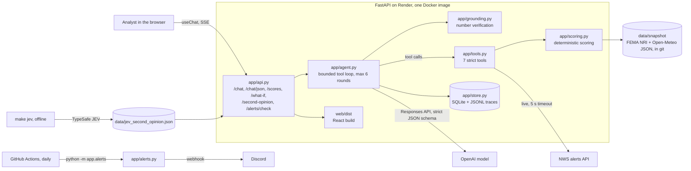

# Architecture

This is the short design document for the Weather Risk Intelligence Agent. It covers the components and how they talk to each other, the repository structure, and the data storage choice. The full design spec, with decisions and alternatives, is in [`specs/2026-11-17-weather-risk-agent-design.md`](specs/2026-11-17-weather-risk-agent-design.md).

## System architecture



### Components

| Component | Responsibility | Talks to |
|---|---|---|
| **Web UI** (`web/`) | React, Vite, Tailwind and shadcn/ui AI Elements. Uses `useChat` from the AI SDK UI. Shows live tool progress, the verified answer card, and widgets drawn from tool outputs. Has voice input and read-aloud. | `POST /chat` (SSE), `GET /scores`, `/hubs`, `/second-opinion`, `POST /what-if` |
| **API** (`app/api.py`) | FastAPI. Validates requests, enforces a per-IP rate limit and a daily cap, streams the agent's turn, and serves the built UI. | Agent, store, scoring, alerts |
| **Agent** (`app/agent.py`) | Vercel AI SDK for Python. A custom `Agent.loop()` runs at most 6 tool rounds, then one final call that must return `AgentAnswer` (a strict JSON schema). It never streams answer text. | OpenAI (Responses API), tools, grounding, store |
| **Tools** (`app/tools.py`) | Seven tools with strict schemas built from Pydantic models: `list_hubs`, `rank_hubs`, `get_hub_risk`, `compare_hubs`, `weather_stat`, `get_active_alerts`, `what_if`. They return structured errors and never raise. | Scoring, snapshot, NWS |
| **Scoring** (`app/scoring.py`) | Pure functions with every number in `ScoringConfig`. Produces exposure (expected disruption days per year), priority, rankings and weather statistics. The same input always gives the same output. | Snapshot |
| **Grounding** (`app/grounding.py`) | Checks that every number in the answer, its assumptions and its uncertainty matches a tool result for the same hub, and that rankings keep the code's order. On failure it retries once, then marks the answer "unverified". | Agent |
| **Store** (`app/store.py`) | SQLite tables for conversations, score history and alerts. JSONL traces record every step (LLM calls, tool calls, grounding, tokens, cost). | API, agent, alerts |
| **Alerts** (`app/alerts.py`) | Recomputes scores and compares them with the committed baseline. Changes of 5 or more points, or a band change, go to the webhook. | GitHub Actions (daily), `POST /alerts/check` |
| **Second opinion** (`app/second_opinion.py`) | Offline. TypeSafe's JEV rates each hub from raw signals only, and the result is saved to a file. It never changes scores. | `make jev`, `GET /second-opinion` |

### One chat turn

1. The UI sends the message to `POST /chat`. The API checks its length, applies the rate limit, and loads the session's history from SQLite.
2. The agent calls the model with the system prompt, the history and the seven tool schemas. The model asks for tools. The code validates the arguments, runs the tools, and returns results or structured errors. Each tool result streams to the UI as a progress step.
3. After at most 6 rounds, the model returns a final `AgentAnswer` that matches the JSON schema.
4. Grounding checks every number against the tool results from this turn and earlier turns. If anything fails, the model gets one retry with the specific errors.
5. The API sends one `data-answer` part with the verified answer and the grounding status. The UI renders it, and the widgets render from the tool outputs. The turn is stored, and the trace is written.

## Repository structure

```
app/            backend
  api.py        FastAPI routes, rate limit, static UI
  agent.py      the bounded agent loop (AI SDK for Python)
  tools.py      seven strict tools
  scoring.py    deterministic scoring, every number in ScoringConfig
  grounding.py  number verification
  schemas.py    shared Pydantic contracts (the single source of truth)
  data.py       public API clients and the snapshot refresh
  store.py      SQLite and JSONL traces
  alerts.py     the score-change alert job
  second_opinion.py  offline JEV cross-check
  prompts/system.md  system prompt
web/            React UI (built into web/dist, served by FastAPI)
data/           hubs.json, snapshot/ (fetched public data, committed), jev_second_opinion.json
evals/          cases.yaml, run.py, judge.py, jev_crosscheck.py, results/
tests/          pytest; offline, with a fake model (ai.testing.FakeModel)
docs/           this file, api-contract.md, specs/, plans/, reviews/, session/
Dockerfile, render.yaml, .github/workflows/   deploy, CI, scheduled alerts
```

## Data storage choice

| Data | Where | Why |
|---|---|---|
| Hub list, FEMA NRI and Open-Meteo history | JSON snapshot committed in git (`data/snapshot/`), refreshed with `make data` | Reproducible scores and evals, reviewable in git, and a live demo that doesn't depend on third-party uptime. The data changes slowly, so there's no reason to fetch it per question. |
| Conversations, score history, sent alerts | SQLite (`data/app.db`) behind `app/store.py` | A small, single-process app that has to run from a clean clone with no setup. Scores and alerts are relational, compared over time, and conversations fit a JSON column. SQLite also gives ACID transactions. |
| Alert baseline | `data/snapshot/score_baseline.json` in git | Render's disk resets on every deploy, so the baseline can't live in SQLite there. |
| Traces | `logs/traces.jsonl` | Enough for debugging. LangSmith or Langfuse would come next. |
| JEV second opinion | `data/jev_second_opinion.json` in git | It's computed offline, so the TypeSafe key never reaches the public server. |

**At scale:**
- **Scores and alerts:** Postgres, for example AWS RDS.
- **Conversation state:** a key-value store, such as DynamoDB keyed by session or Redis with a TTL.
- **Weather history:** Parquet on S3, queried with DuckDB or Athena.
- **Refresh:** a scheduled ingestion job.

Only `store.py` and `data.py` would change. Data volume isn't the reason to move: 1,500 hubs is still small. Concurrency, several API instances and operations are.
