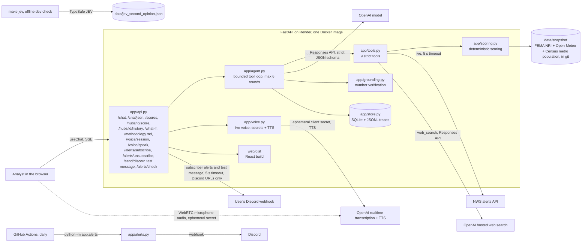

# Architecture

This is the short design document for the Weather Risk Intelligence Agent. It covers the components and how they talk to each other, the repository structure, and the data storage choice. The full design spec, with decisions and alternatives, is in [`specs/2026-11-17-weather-risk-agent-design.md`](specs/2026-11-17-weather-risk-agent-design.md).

## System architecture



### Components

| Component | Responsibility | Talks to |
|---|---|---|
| **Web UI** (`web/`) | React, Vite, Tailwind and shadcn/ui AI Elements. Uses `useChat` from the AI SDK UI. Shows live tool progress, the verified answer card, and widgets drawn from tool outputs (rankings, hub breakdown with "See the math", comparison table, history, weather statistic, alerts, what-if). The Scores tab has the table, an offline US map (react-simple-maps), what-if sliders and CSV export. The methodology renders in the app with KaTeX. Voice input, read-aloud, live voice (`web/src/lib/liveVoice.ts`: WebRTC transcription, TTS playback, barge-in), web sources as links, and a developer validation panel. "Send & alerts" (sidebar) subscribes a Discord webhook to score-change alerts and remembers it in localStorage. | `POST /chat` (SSE), `GET /scores`, `/hubs`, `/hubs/{id}/score`, `/hubs/{id}/history`, `/methodology.md`, `POST /what-if`, `/alerts/subscribe`, `/alerts/unsubscribe`, `/send/discord`, `POST /voice/session`, `GET /voice/speak`, OpenAI `realtime/calls` (WebRTC) |
| **API** (`app/api.py`) | FastAPI. Validates requests, enforces per-IP rate limits (10 a minute for `/chat` plus a daily cap of 300; 120 a minute for the no-LLM routes `/what-if`, `/hubs/{id}/score`, `/hubs/{id}/history`; 5 a minute for `/send/discord`, `/alerts/subscribe` and `/alerts/unsubscribe`; `/voice/session` uses the chat limit plus a daily live-voice cap; every 429 carries `Retry-After`), streams the agent's turn, and serves the built UI. | Agent, store, scoring, alerts, send |
| **Send** (`app/send.py`) | The Discord webhook URL guard (https, host exactly `discord.com` or `discordapp.com`, path `/api/webhooks/<id>/<token>`, no port, user info, query or IP literal) and one POST with a 5 s timeout, no redirects and mentions disabled. Errors never contain the URL. | Discord |
| **Agent** (`app/agent.py`) | Vercel AI SDK for Python. A custom `Agent.loop()` runs at most 6 tool rounds, then one final call that must return `AgentAnswer` (a strict JSON schema). It never streams answer text. | OpenAI (Responses API), tools, grounding, store |
| **Tools** (`app/tools.py`) | Nine tools with strict schemas built from Pydantic models: `list_hubs`, `rank_hubs`, `get_hub_risk`, `compare_hubs`, `weather_stat`, `get_hub_history`, `get_active_alerts`, `what_if`, and `web_search` (`app/websearch.py`: OpenAI hosted web search through the Responses API, current news only, results limited to URLs the search really used). City names resolve to hubs through OMB metro areas. The tools return structured errors and never raise. | Scoring, snapshot, NWS, OpenAI web search |
| **Live voice** (`app/voice.py`) | `POST /voice/session` mints a 60-second client secret for a transcription-only realtime session (chat rate limit, daily cap of 40, 10-minute sessions). `GET /voice/speak?trace_id=` streams OpenAI TTS of the answer this server verified for that turn, at most twice; a failed answer is never read out. | OpenAI realtime client secrets, OpenAI audio/speech |
| **Scoring** (`app/scoring.py`) | Pure functions with every number in `ScoringConfig`. Produces exposure (expected disruption days per year), the bad year (exact TVaR95), review priority, people served and people-days, rankings and weather statistics. The same input always gives the same output. `SCORING_VERSION` names the method. | Snapshot |
| **Grounding** (`app/grounding.py`) | Checks that every figure matches the exact field it cites (tool, field, hub, family; for `web_search`, the result URL, and the number must be in that result's title or snippet), that every number in the answer, its assumptions and its uncertainty is one of those figures, and that rankings keep the code's order. On failure it retries once, then marks the answer "unverified". | Agent |
| **Store** (`app/store.py`) | SQLite tables for conversations, score history, sent alerts and alert subscriptions (`alert_subscriptions`: Discord webhook URL, created at; at most 50). JSONL traces record every step (LLM calls, tool calls, grounding, tokens, cost). | API, agent, alerts |
| **Alerts** (`app/alerts.py`) | Recomputes scores and compares them with the committed baseline. A 5-point score change, 3 bad-year days, 10 points of hurricane probability, or a level change at least 2 points past the cut-off goes to the webhook, once per change, and then to every subscribed Discord webhook (a webhook Discord no longer knows is removed). A formula version (`SCORING_VERSION` plus a hash of the config) resets the comparison when the method changes. | GitHub Actions (daily), `POST /alerts/check` |
| **Second opinion** (`app/second_opinion.py`) | Offline. TypeSafe's JEV rates each hub from raw signals only, and the result is saved to a file. It never changes scores. | `make jev` (development check, not shown in the UI) |

### One chat turn

1. The UI sends the message to `POST /chat`. The API checks its length, applies the rate limit, and loads the session's history from SQLite.
2. The agent calls the model with the system prompt, the history and the nine tool schemas. The model asks for tools. The code validates the arguments, runs the tools, and returns results or structured errors. Each tool result streams to the UI as a progress step.
3. After at most 6 rounds, the model returns a final `AgentAnswer` that matches the JSON schema.
4. Grounding checks every number against the tool results from this turn and earlier turns. If anything fails, the model gets one retry with the specific errors.
5. The API sends one `data-answer` part with the verified answer and the grounding status. The UI renders it, and the widgets render from the tool outputs. The turn is stored, and the trace is written.
6. In live voice, the question came from the realtime transcription, and the browser then plays `GET /voice/speak?trace_id=<this turn>`: the server speaks the verified answer text it kept for that turn, never text from the client.

## Repository structure

```
app/            backend
  api.py        FastAPI routes, rate limit, static UI
  agent.py      the bounded agent loop (AI SDK for Python)
  tools.py      nine strict tools, metro-area name resolution
  websearch.py  the web_search tool (OpenAI hosted web search, Responses API)
  voice.py      live voice: realtime transcription secrets, TTS of verified answers
  followups.py  suggested next questions, built by code
  scoring.py    deterministic scoring, every number in ScoringConfig
  grounding.py  number verification
  schemas.py    shared Pydantic contracts (the single source of truth)
  data.py       public API clients and the snapshot refresh
  store.py      SQLite and JSONL traces
  send.py       Discord webhook URL guard and poster (test message, subscriber alerts)
  alerts.py     the score-change alert job
  second_opinion.py  offline JEV cross-check
  prompts/system.md  system prompt
web/            React UI (built into web/dist, served by FastAPI)
data/           hubs.json, metro_cities.json, hub_nicknames.json, snapshot/ (fetched public data and provenance, committed), jev_second_opinion.json
evals/          cases.yaml, run.py, judge.py, jev_crosscheck.py, results/
tests/          pytest; offline, with a fake model (ai.testing.FakeModel)
docs/           this file, ASSIGNMENT_COVERAGE.md (each line of the brief and where it is met), METHODOLOGY.md (also served in the app),
                USER_GUIDE.md, SUBMISSION.md, api-contract.md, specs/, plans/, reviews/, session/ (the AI session transcripts)
Dockerfile, render.yaml, .github/workflows/   deploy, CI, scheduled alerts
```

## Data storage choice

| Data | Where | Why |
|---|---|---|
| Hub list, FEMA NRI, Open-Meteo history and Census metro population | JSON snapshot committed in git (`data/snapshot/`, with `provenance.json` naming each source and vintage), refreshed with `make data` | Reproducible scores and evals, reviewable in git, and a live demo that doesn't depend on third-party uptime. The data changes slowly, so there's no reason to fetch it per question. |
| Chat history (for the user) | The browser (localStorage), sent back with each request | Survives Render redeploys without accounts. The server rebuilds context from it when its own store was reset |
| What this browser subscribed (webhook, on or off) | The browser (localStorage) | Lets the panel show the switches; the server keeps the subscriptions themselves |
| Conversations, score history, sent alerts, alert subscriptions | SQLite (`data/app.db`) behind `app/store.py` | A small, single-process app that has to run from a clean clone with no setup. Scores and alerts are relational, compared over time, and conversations fit a JSON column. SQLite also gives ACID transactions. |
| Alert baseline and state | `data/snapshot/score_baseline.json` in git, plus a state file the scheduled job keeps in the GitHub Actions cache | Render's disk resets on every deploy. Both carry a scoring formula version, so a method change resets them instead of firing false alerts. |
| Traces | `logs/traces.jsonl` | Enough for debugging. LangSmith or Langfuse would come next. |
| JEV second opinion | `data/jev_second_opinion.json` in git | It's computed offline, so the TypeSafe key never reaches the public server. |

**At scale:**
- **Scores and alerts:** Postgres, for example AWS RDS.
- **Conversation state:** a key-value store, such as DynamoDB keyed by session or Redis with a TTL.
- **Weather history:** Parquet on S3, queried with DuckDB or Athena.
- **Refresh:** a scheduled ingestion job.

Only `store.py` and `data.py` would change. Data volume isn't the reason to move: 1,500 hubs is still small. Concurrency, several API instances and operations are.
